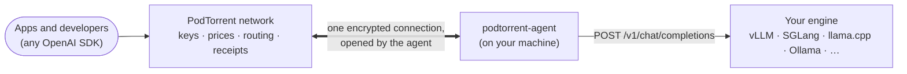

<div align="center">


# podtorrent-agent

### Your engine. The world's requests.

Already serving a model with vLLM, SGLang, TensorRT-LLM, llama.cpp, Ollama or exo? This small program connects it to PodTorrent, a global OpenAI-compatible inference market. Set your price, keep your stack exactly as it is, and get paid for every token you serve.

[](https://github.com/podtorrent/podtorrent-agent/actions/workflows/ci.yml)
[](LICENSE)


[Is this for me?](#is-this-for-me) · [Quick start](#quick-start) · [Try it first](#try-it-on-your-laptop-first) · [Install](#install) · [Safe by design](#safe-by-design) · [More setups](#more-setups) · [Troubleshooting](#troubleshooting) · [Docs](#documentation)

</div>

## What it does

You run an inference engine. PodTorrent has people who need tokens. The agent sits next to your engine and joins the two:



1. The agent **dials out** to the network. You open no ports, so it works behind NAT, home routers and strict firewalls.
2. It tells the network which models you serve, how many requests you take at once, and your price.
3. When a request arrives, the agent passes it to your engine **unchanged** and streams the answer back **unchanged**.
4. Every request gets a **signed receipt** from both sides. You're paid for what both agree you served.

That's all it does. It doesn't download models, touch your GPU or need root.

## Is this for me?

| You have | Use |
| --- | --- |
| An engine already serving the OpenAI API (vLLM, SGLang, TensorRT-LLM, llama.cpp server, Ollama, LM Studio, …) on a server, a workstation or a whole cluster | **This agent.** One agent per engine, as many as you run. |
| Several Macs running [exo](https://github.com/exo-explore/exo) | **This agent**, with `-engine-kind exo`. The whole cluster joins as one node. [Guide](docs/exo.md). |
| A video model running in ComfyUI | **This agent** plus `podtorrent-comfy-video`, included. [Guide](docs/comfyui-video.md). |
| A Mac, gaming PC, AMD Ryzen AI Max box or Jetson, and nothing set up yet | **[The PodTorrent app](https://github.com/podtorrent/podtorrent-desktop).** It downloads a model, runs it and connects it for you (it uses this agent inside). |

## Quick start

About ten minutes if your engine is already running.

### 1. Check your engine answers

The agent talks to your engine's OpenAI API. Make sure it's up and note the exact model id it lists:

```bash
curl http://127.0.0.1:8000/v1/models
```

Not sure of the address? Most engines use one of these:

| Engine | Usual address (`-engine`) |
| --- | --- |
| vLLM, TensorRT-LLM (`trtllm-serve`) | `http://127.0.0.1:8000` |
| SGLang | `http://127.0.0.1:30000` |
| llama.cpp server | `http://127.0.0.1:8080` |
| Ollama | `http://127.0.0.1:11434` |
| LM Studio | `http://127.0.0.1:1234` |
| exo | `http://127.0.0.1:52415` (add `-engine-kind exo`) |

### 2. Get a node token

Register your node at **[podtorrent.com/register-node](https://podtorrent.com/register-node)**. You'll get access to the operator dashboard, where you create a **node token**. Treat it like a password: it's what identifies your node.

### 3. Describe what you serve

Save this as `manifest.json`, with your model id from step 1 and your own prices:

```json
{
  "node": "example-node-01",
  "models": [
    { "id": "Qwen/Qwen3-30B-A3B", "slots": 8 }
  ],
  "price": { "per_mtok_in": 0.05, "per_mtok_out": 0.40 }
}
```

- **`id`**: exactly as `/v1/models` printed it.
- **`slots`**: the most requests your engine should handle at once. The network never sends more.
- **`price`**: US dollars per million input and output tokens. Use `0` to serve for free.

That's the minimum. Quantisation, context length, speed, batch pricing and more are optional ([manifest reference](docs/operator-guide.md#manifest-reference)).

### 4. Run the agent

Download it ([below](#install)), then:

```bash
export PODTORRENT_NODE_TOKEN=your-node-token
podtorrent-agent -engine http://127.0.0.1:8000 -manifest manifest.json
```

The agent checks that your engine lists every model in the manifest, connects, and waits for work. Your requests, tokens per second and earnings show up in the [operator dashboard](https://dashboard.podtorrent.com/operator).

Prefer Docker?

```bash
docker run -d --name podtorrent-agent --restart unless-stopped \
  --read-only --cap-drop ALL --security-opt no-new-privileges \
  -e PODTORRENT_NODE_TOKEN=your-node-token \
  -v "$PWD/manifest.json:/manifest.json:ro" \
  ghcr.io/podtorrent/podtorrent-agent:latest \
  -manifest /manifest.json -engine http://engine:8000
```

(`engine` is your engine's hostname on the Docker network. If the engine runs on the host itself, use `http://host.docker.internal:8000` on macOS and Windows, or add `--network host` on Linux.)

**Changing prices or models later?** Just edit `manifest.json`. The agent picks it up within 5 seconds, with no restart, and requests in flight carry on.

## Try it on your laptop first

No token, no engine, no real network needed. The repo includes a fake engine and a fake network so you can watch a request go all the way through:

```bash
git clone https://github.com/podtorrent/podtorrent-agent && cd podtorrent-agent
make dev    # needs Go 1.24+; starts a mock engine, a mock network and the agent
```

In a second terminal, be the customer:

```bash
curl -N localhost:8787/v1/chat/completions -H 'Authorization: Bearer dev-api-key' \
  -d '{"model":"mock/echo-1","stream":true,"messages":[{"role":"user","content":"hi"}]}'
```

**Test your real engine before going live:** run `./bin/mock-network` on its own and point the agent at your engine instead. The [operator guide](docs/operator-guide.md#test-before-going-live) has the exact commands.

## Install

| Option | How |
| --- | --- |
| **Download a binary** | From [Releases](https://github.com/podtorrent/podtorrent-agent/releases) for Linux (x86-64, ARM64), macOS (Apple Silicon) and Windows (x86-64). Check it against `SHA256SUMS`. |
| **Container** | `ghcr.io/podtorrent/podtorrent-agent:<version>` (or `:latest`), for `linux/amd64` and `linux/arm64`. Distroless, non-root, no shell. |
| **Build from source** | `make build` with Go 1.24+. Binaries land in `bin/`. |

On Linux, for example:

```bash
VERSION=v0.5.0
curl -LO https://github.com/podtorrent/podtorrent-agent/releases/download/$VERSION/podtorrent-agent-$VERSION-linux-amd64
curl -LO https://github.com/podtorrent/podtorrent-agent/releases/download/$VERSION/SHA256SUMS
sha256sum --ignore-missing -c SHA256SUMS
chmod +x podtorrent-agent-$VERSION-linux-amd64 && sudo mv podtorrent-agent-$VERSION-linux-amd64 /usr/local/bin/podtorrent-agent
```

To keep it running after you log out, use your service manager: a systemd unit with `Restart=always`, or the Docker command above with `--restart unless-stopped`.

## How you earn

- **You set the price.** Per million input, cached input and output tokens, per model if you like, with a separate price for batch work. Or free.
- **Two kinds of work.** *Interactive* requests (someone is waiting) go to the node with the most free capacity. *Batch* requests (cost matters most) fill up busy nodes first. Take one or both, and keep some slots for interactive work with `interactive_reserve`.
- **Buyers can set a price ceiling**, so the network sends each request to a node within budget, preferring lower prices and verified nodes.
- **Cached prompts.** If buyers keep sending the same long system prompt, keep it warm in your engine's cache and advertise it: you get those requests first and skip the work.

Details: [tiers and pricing](docs/operator-guide.md#tiers-and-pricing), [cached prompts](docs/operator-guide.md#cached-prompts).

## Safe by design

The agent is built so a careful operator, or a security team, can say yes to it quickly.

| | |
| --- | --- |
| **No open ports** | It makes one outbound TLS connection (port 443). Nothing listens unless you choose inbound mode. |
| **Least privilege** | One ~6 MB static binary, or a distroless non-root container. No GPU, no host disk, no root, no shell. |
| **It can only do three things** | Call your engine's `POST /v1/chat/completions`, `GET /v1/models` and, for video models, the video job API (with exo, also its two model-status endpoints, never the one that holds prompts). Nothing else on your engine, nothing else on your network. |
| **Reads one file** | Your manifest (plus TLS files in inbound mode). It never downloads models or code. |
| **Logs no content** | Prompts and answers are never logged, only request ids and errors. |
| **Signed receipts** | Each request is signed by your node and countersigned by the network (Ed25519), recording token counts only. |
| **Open source** | Apache-2.0, small enough to read in an afternoon ([architecture](docs/architecture.md)). Release binaries and images are built by public CI. |

**What your node sees.** Like any inference provider, your engine sees the prompts and answers it serves. The agent doesn't store them.

Found a vulnerability? Please report it privately: [SECURITY.md](SECURITY.md).

## More setups

| I want to… | Guide |
| --- | --- |
| Serve from several Macs as one node with exo | [exo clusters](docs/exo.md) |
| Serve a video model that runs in ComfyUI | [ComfyUI video models](docs/comfyui-video.md) |
| Serve a video model from another engine | [Operator guide → What you need](docs/operator-guide.md#what-you-need) and the spec's Video section |
| Have an AI coding agent (Claude Code, Codex, Cursor…) set it all up for me | [Prompts for your coding agent](docs/agent-prompts.md) |
| Use a private link instead of outbound (Cloudflare Tunnel, WireGuard) or inbound with mutual TLS | [Connection modes](docs/connection-modes.md) |
| Watch it in Prometheus / Grafana | `-metrics-listen 127.0.0.1:9100`, then [metrics](docs/operator-guide.md#metrics) |
| See every flag and environment variable | [Flags and environment](docs/operator-guide.md#flags-and-environment) |

## Troubleshooting

| The log says | What to do |
| --- | --- |
| `PODTORRENT_NODE_TOKEN is not set` | Set the environment variable to your node token. |
| `engine at ... not reachable` | Your engine isn't running at the `-engine` address, or the container can't reach it. Try the `curl` from step 1. |
| `engine ... does not list these manifest models` | Make each `id` in your manifest match `/v1/models` exactly, character for character. |
| `link down, reconnecting ... 401` | Wrong or revoked node token. Create a new one in the operator dashboard. |
| `link down, reconnecting ... dial` | The machine can't reach the network on port 443. Check your firewall or proxy. |

More in the [operator guide](docs/operator-guide.md#troubleshooting).

## For developers

- **Open protocol.** The agent speaks [`spec/protocol-v0.md`](spec/protocol-v0.md). Any program that implements it is a valid node; this repo is the reference implementation. Writing your own? Check it with `podtorrent-conformance`, which plays the network and prints `conformant` when every check passes.
- **Go API.** [`pkg/`](pkg/) lets you build on the agent, as the desktop app does: `manifest` (load, validate, save), `engine` (check an engine, test a streamed chat), `node` (run the agent in-process) and `selftest` (check a setup on loopback). See `go doc ./pkg/...`.
- **Build and test.** `make build`, `make test`, `make lint`. See [CONTRIBUTING.md](CONTRIBUTING.md).

| Path | What's there |
| --- | --- |
| `cmd/podtorrent-agent` | The agent |
| `cmd/podtorrent-comfy-video` | Video job API in front of ComfyUI |
| `cmd/podtorrent-conformance` | Protocol checks for any node |
| `cmd/mock-engine`, `cmd/mock-network` | Fakes for local testing |
| `internal/agent` | The link, slots and forwarding: most of the logic |
| `internal/protocol` | Wire types, matching the spec |
| `pkg/` | Public Go API |
| `spec/` | The protocol spec |
| `docs/` | Guides |

## Documentation

| Document | For |
| --- | --- |
| [Operator guide](docs/operator-guide.md) | Installing and running a node, the full manifest reference, metrics, troubleshooting |
| [docs.podtorrent.com](https://docs.podtorrent.com) | The network: running a node, prices, privacy, receipts, the operator dashboard, using the API |
| [Prompts for your coding agent](docs/agent-prompts.md) | Letting an AI coding agent survey your engine and launch a text or video model |
| [exo clusters](docs/exo.md) | Several Macs as one node, and closing exo's port to your network |
| [ComfyUI video models](docs/comfyui-video.md) | Serving a ComfyUI video workflow with `podtorrent-comfy-video` |
| [Connection modes](docs/connection-modes.md) | Outbound, private links (Cloudflare Tunnel, WireGuard), inbound with mutual TLS |
| [Protocol spec v0](spec/protocol-v0.md) | Writing your own agent or client |
| [Architecture](docs/architecture.md) | How the agent works inside |
| [Roadmap](docs/roadmap.md) | What's done and what's next |
| [Changelog](CHANGELOG.md) | What changed in each release |
| [AGENTS.md](AGENTS.md) | Instructions for AI coding agents working in this repo |

## Contributing and license

Issues and pull requests are welcome, especially for new engines and setups. Start with [CONTRIBUTING.md](CONTRIBUTING.md).

Apache-2.0: see [LICENSE](LICENSE). The license covers the code, not the PodTorrent name or logo. Security issues: [SECURITY.md](SECURITY.md).
